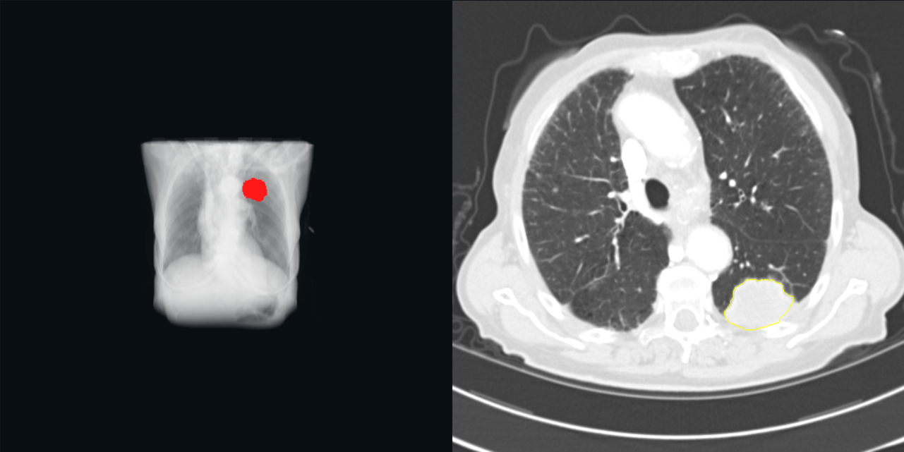
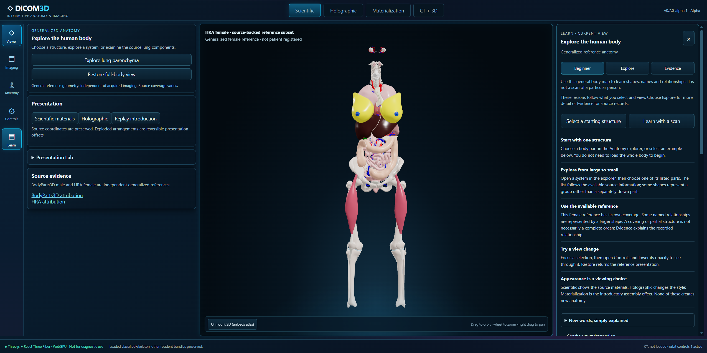
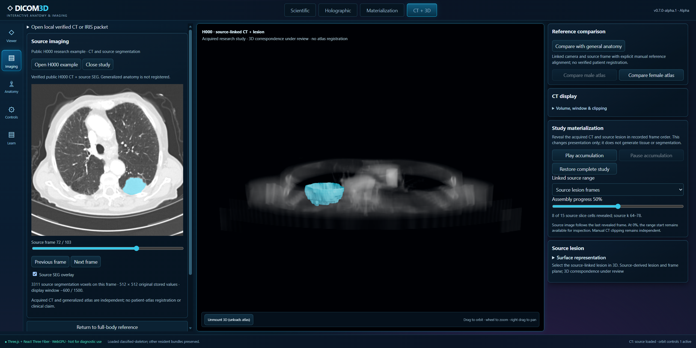

# NRX and DICOM3D v0.7.0-alpha.1 — independent review

This branch is the temporary public **source-review home** of NRX research and the Three.js / React Three Fiber alpha. The operator authorized this destination on 2026-11-06. It is not a release, Pages deployment, replacement of the installed application, or production renderer certification.

Start here on mobile, then read:

1. [NRX research handoff and capability matrix](research/nrx/HANDOFF.md).
2. [Alpha status and asset boundary](prototypes/alpha/README.md).
3. [Exact source manifest](research/nrx/SOURCE_MANIFEST.json), [fresh witness](research/nrx/evidence/FRESH_WITNESS.json), and [measured resources](research/nrx/evidence/RESOURCES_AND_INTEGRITY.json).
4. [Independent review prompt](research/nrx/REVIEW_PROMPT.md).

The root README is the established public-product document and is intentionally preserved for the next reviewer to reconcile. It does **not** describe this entire research branch. Product identity: **an open-source interactive anatomy and medical imaging platform**.

The existing `main` product snapshot is preserved as the base. Research is under `research/nrx/`; alpha source is under `prototypes/alpha/`. The separately owned AI Hub checkout and local history are untouched. Earlier `experimental` history is retained as a parent of the handoff commit; no force push or history deletion is needed.

## What actually passed

- Fresh genuine Wasm64 compilation of the native CT and editable-field targets. Both binaries reproduce the accepted historical SHA-256 values.
- Fresh headed Edge on RX 7900 XT: native WebGPU H000 rendering, source-linked selection, smooth reference surface, actual brush/undo controls, learning inspection, and zero owned native/bridge/pending resources at close.
- The alpha's separate local pass covered beginner contextual Learn, male/female reference contexts, H000 accumulation, eight-second materialization, explicit Skip/reduced motion, and teardown at the recorded scopes.

## What this branch is not

No patient scans or reports, private DICOMs, raw restricted evidence, service credentials, or installed runtime is included. The expanded BodyParts3D atlas and HRA delta ship on this branch under CC BY 4.0. DICOM3D code is Apache 2.0. Broader atlas completeness, arbitrary organ segmentation, whole-scan NRX tissue reconstruction, live IRIS admission, and clinical accuracy are not established.

Public-safe captures below come from the identified local witnesses, not a deployed alpha.

