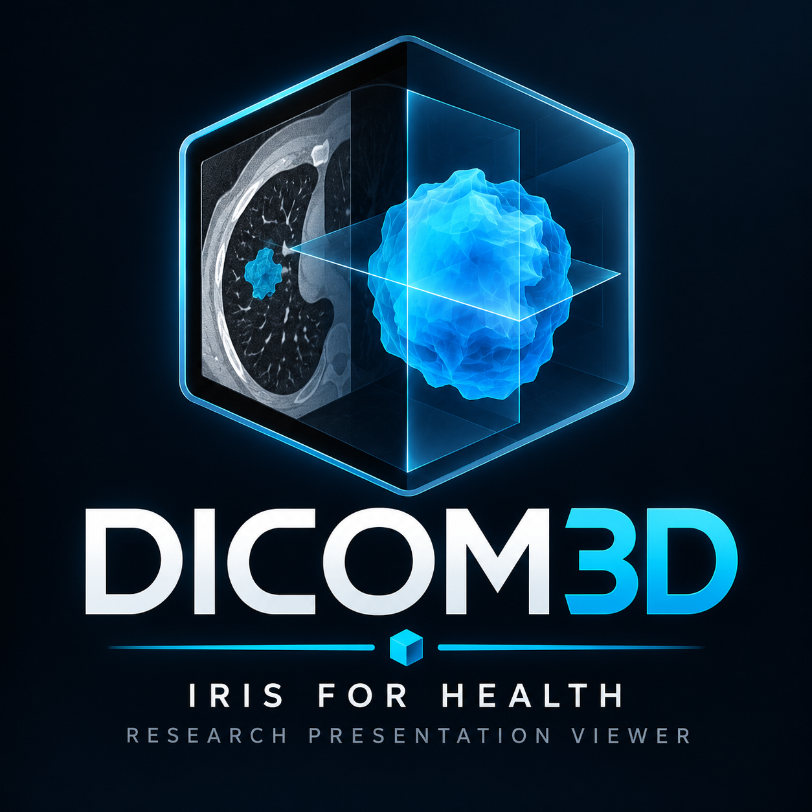

# DICOM3D

  <a href="https://kennethjsmithdev.github.io/DICOM3D/"><strong>Live Demo</strong></a>
  &nbsp;·&nbsp;
  <a href="docs/INSTALL_051.md#optional-protected-irisipm-distribution"><strong>Native Install QuickStart</strong></a>
  &nbsp;·&nbsp;
  <a href="docs/CORE_DOCKER_QUICKSTART.md"><strong>Docker Quick Start</strong></a>

**v0.5.1 installation recovery is published.** The [GitHub release](https://github.com/KennethJSmithDev/DICOM3D/releases/tag/v0.5.1) was published October 20, 2026 from `f03162cdec8b89a522dd4032e3815ea7d3ed0401`. Its seven frozen assets were promoted without rebuilding; preparation-time candidate fields remain provenance. Open Exchange/IPM publication is a separate gate. The published v0.5.0 release remains immutable.

DICOM3D is a desktop-first research imaging and generalized-anatomy explorer. No patient study is required to explore the licensed male BodyParts3D and female HRA reference subsets. Reference anatomy and patient-specific evidence remain separate.

Start with the [installation guide](docs/INSTALL_051.md) or [standalone Docker quick start](docs/CORE_DOCKER_QUICKSTART.md). Read the [release scope](docs/RELEASE_051.md), [compatibility and limitations](docs/COMPATIBILITY_051.md), and [changelog](CHANGELOG.md). The [v0.5.0 release scope](docs/RELEASE_050.md) remains the historical record.

## v0.5.1 distributions

- **Standalone Core**: self-contained source/assets ZIP, digest-pinned Docker build, loopback-only static host, automatic male/female reference loading. No IRIS, login, server upload or patient imaging is bundled.
- **IPM**: the same built reference viewer and assets, plus the existing password/resource-protected IRIS hosting wrapper and read-only identity endpoint. This does not configure FHIR, clinical integrations or optional Connect.
- **Optional IRIS Docker development host**: [isolated durable-volume bootstrap](docs/IRIS_DOCKER_DEV_051.md) distinguishes container startup from IPM installation. The legacy [IRIS Docker quickstart](docs/DOCKER_QUICKSTART.md) remains a historical v0.1.0 profile, not the v0.5.0 standalone Core procedure.
- **GitHub is authoritative** for the exact release files and SHA256SUMS. Open Exchange and its IPM registry may update later; verify the actual installed version rather than inferring it from a listing. Read the [installation guide](docs/INSTALL_051.md) and verify the installed version.

The [public anatomy demo](https://kennethjsmithdev.github.io/DICOM3D/) now opens the generalized male reference with female switching, interactive selection and reversible presentation. It is browser-only and not a clinical viewer. Published [v0.1.0](https://github.com/KennethJSmithDev/DICOM3D/releases/tag/v0.1.0) and [v0.2.0](https://github.com/KennethJSmithDev/DICOM3D/releases/tag/v0.2.0) remain immutable.

## Milestone and evidence history

The public Git history consolidates numerous locally qualified development gates into the v0.5.0 promotion. The documented sequence is **H000 source CT/SEG → spatial/semantic GLB**, **V010 IRIS/IPM lifecycle**, **H002 synthetic presentation slices**, **MOD/VIS multimodality and anatomy**, **CONNECTED-001/CONNECT-002 evidence exploration**, **MOD-QUAL/MOD-REPAIR imaging qualification**, **UX-INTERACTION/UX-RACE fixes**, and **RELEASE-050 / DEMO-050 packaging and public demonstration**. The named local receipts, not commit times alone, establish individual test claims; some acceptance evidence is preserved in CompDocs rather than this repository. No unqualified clinical or production Connect capability is implied.

Public checkpoints: [v0.1.0](https://github.com/KennethJSmithDev/DICOM3D/releases/tag/v0.1.0) · [v0.2.0](https://github.com/KennethJSmithDev/DICOM3D/releases/tag/v0.2.0) · [v0.5.0](https://github.com/KennethJSmithDev/DICOM3D/releases/tag/v0.5.0) · [v0.5.1](https://github.com/KennethJSmithDev/DICOM3D/releases/tag/v0.5.1). See the [changelog](CHANGELOG.md) and [release scope](docs/RELEASE_051.md).

## Experience and evidence

Explore 33 male and 22 female semantic structures with selection, visibility, isolation, opacity, clipping, camera presets and restoration. The references have partial coverage and different sources; they are not one registered patient scan. Skin remains rendered and explicitly selectable from the list while exposed eligible anatomy can be picked in the canvas.

Local acquired-CT frame/volume presentation requires separately qualified local pixels, metadata and source transforms. The browser also accepts converted local image bundles. It is not a universal native DICOM decoder or PACS. Modality recognition, pixel decoding, display and independent qualification are distinct capabilities.

DICOM/source arrays remain authoritative. Derived meshes preserve provenance and spatial identity. Camera, materials, window/level, clipping and reversible presentation transforms do not become medical observations. No calibrated HU/SUV, anatomical accuracy, diagnostic validity, new segmentation, AI interpretation or physiological simulation is claimed.

## Development

Use the pinned viewer lockfile with Node.js 24 and `npm ci` in `viewer/`. Run `npm run dev` and open `/reference.html`; the default `/` development entry remains the earlier local-study shell. The Core Dockerfile builds `vite.reference.config.mjs`. Existing `scripts/stage-package.ps1`, `scripts/archive-package.py` and `scripts/archive-core.py` prepare the release distributions. No third-party renderer or additional runtime dependency is introduced.

## License

Apache-2.0; copyright 2026 KennethJSmithDev personally. Preserve LICENSE, NOTICE and third-party notices. BodyParts3D-derived assets retain CC BY-SA 2.1 Japan attribution; HRA assets retain CC BY 4.0 attribution and source limitations. Their notices accompany the reference assets. Optional IRIS software is acquired separately under its applicable license.
