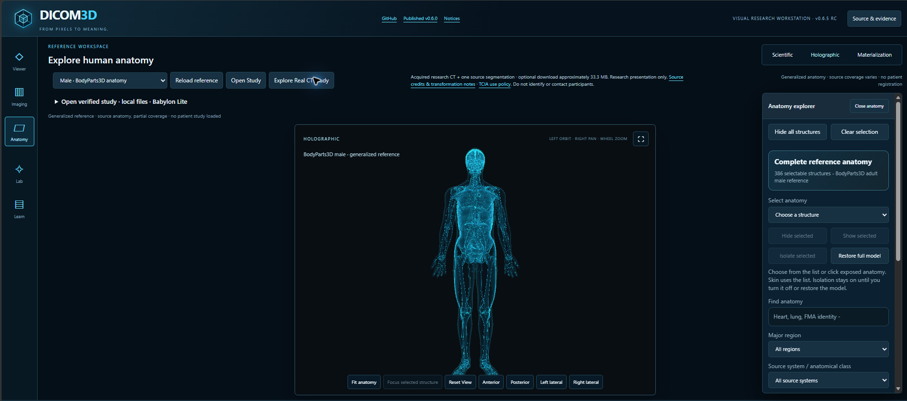
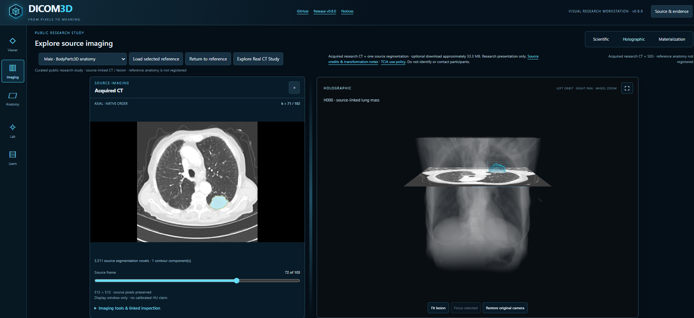
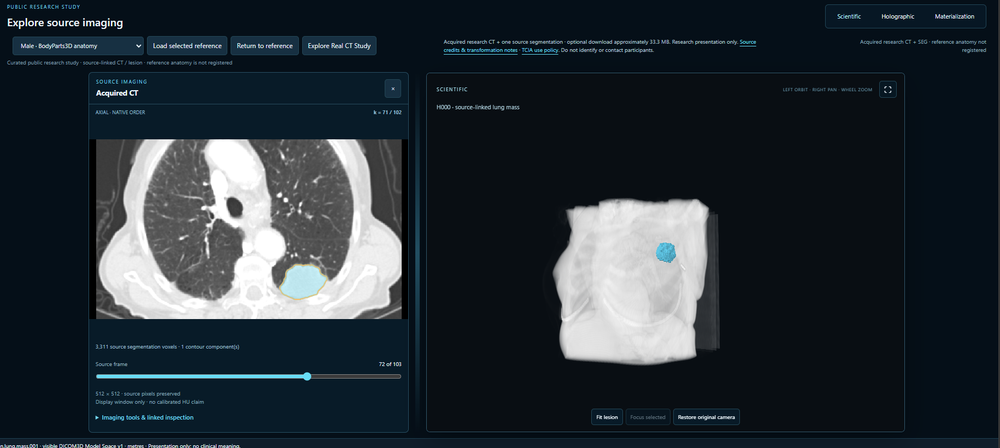
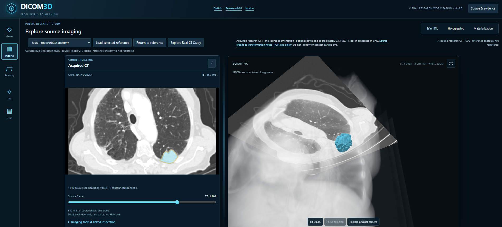

# DICOM3D

<p align="center">
  <a href="https://kennethjsmithdev.github.io/DICOM3D/"><strong>Live Demo</strong></a>
  &nbsp;·&nbsp;
  <a href="docs/INSTALL_060.md"><strong>v0.6.0 Native Install</strong></a>
  &nbsp;·&nbsp;
  <a href="docs/CORE_DOCKER_QUICKSTART.md"><strong>v0.6.0 Docker Quick Start</strong></a>
</p>

<p align="center"></p>

**v0.6.5 — Visual Research Workstation.** *From Pixels to Meaning.*

DICOM3D is an open-source, desktop-first research workstation for exploring generalized anatomy and viewing source-linked CT and segmentation. Use Scientific, Holographic, and Materialization modes to change the presentation while retaining the source geometry.

The [Live Demo](https://kennethjsmithdev.github.io/DICOM3D/) opens directly in a desktop browser with WebGPU. DICOM3D is research software for visualization and learning. Clinical use and production PACS integration are outside its qualified scope.

## Downloads

- **v0.6.5 Safe Demo and Core source.** The Safe Demo ZIP runs locally with Node.js 24 and includes the optional public CT example. The Core ZIP contains source for the reference workstation. [v0.6.5 downloads and launch instructions](https://github.com/KennethJSmithDev/DICOM3D/releases/tag/v0.6.5)
- **v0.6.0 Core/Docker and IRIS/IPM.** The qualified installation archives contain reference anatomy. The Core build runs independently. The IPM package uses the protected IRIS for Health viewer. [v0.6.0 downloads](https://github.com/KennethJSmithDev/DICOM3D/releases/tag/v0.6.0) · [Installation guide](docs/INSTALL_060.md) · [Packaging provenance](docs/PACKAGING_060.md)

See the [changelog](CHANGELOG.md) and [release history](ROADMAP.md) for earlier checkpoints.

## Experience and evidence



**Explore reference anatomy.** Select from **386 BodyParts3D male** and **380 HRA female** source-backed groups. Use source-preserving selection, visibility, isolation, opacity, camera controls and restoration. The references have different sources, partial anatomical coverage and **no registration to a patient study**.

**Choose the presentation.** Scientific mode displays source-oriented materials; Holographic mode provides controlled cyan translucency; Materialization offers bounded source-derived assembly effects and reduced-motion controls. These affect presentation only, not anatomy, measurements or medical evidence. See the historical v0.6.0 [female anatomy](docs/images/visual-060-female-desktop.jpg) and [materialization](docs/images/visual-060-materialization.jpg) screenshots.

**Explore the public CT example.** Select **Explore public CT example** in the Live Demo to load the curated H000 study, including source CT frames, segmentation contours, and a linked 3D lesion view. Generalized anatomy has no registration to the study. [Public research data policy](docs/PUBLIC_RESEARCH_DATA_POLICY.md)

Public H000 CT/SEG source and 3D views (v0.6.0 workstation captures):







**Learn in context.** The **Learn** workspace explains active structures, source identity, rendering choices, limits and attribution alongside the experience. See the historical v0.6.0 [contextual learning capture](docs/images/visual-060-learning.jpg).

**Open verified local CT** accepts a verified volume descriptor and its stored pixels. The files stay in the browser. The manifest records semantic identity, spatial transforms, and provenance. GLB carries derived geometry, and Babylon Lite renders the presentation. [Architecture](docs/ARCHITECTURE.md)

## Build from source

Use Node.js 24 and the pinned viewer dependencies.

```powershell
npm ci --prefix viewer
node scripts/build-demo.mjs --profile curated-h000
node scripts/test-demo.mjs --profile curated-h000
node scripts/preview-static.mjs --root .demo-dist --port 0
```

Open the loopback URL printed by the preview server. The default build profile includes reference anatomy. The curated profile also includes the five approved CT/SEG research files. [Safe Demo build guide](docs/SAFE_DEMO.md)

## License

DICOM3D software is Apache-2.0; copyright 2026 KennethJSmithDev personally. Preserve [LICENSE](LICENSE), [NOTICE](NOTICE), and third-party notices. BodyParts3D-derived assets retain the source-specific CC BY-SA 2.1 Japan attribution and additional publisher-license details documented in the [BodyParts3D notice](reference/public/reference/BODYParts3D-NOTICE.txt); the current BodyParts3D publisher license identifies CC BY 4.0; preserve the historical source notice. HRA retains [CC BY 4.0 attribution](reference/public/reference/HRA-FEMALE-NOTICE.txt) and source limitations. The optional H000 research study has its own [source and usage notice](reference/public/demo/h000/NOTICE.md). IRIS software is acquired separately under its applicable license.
