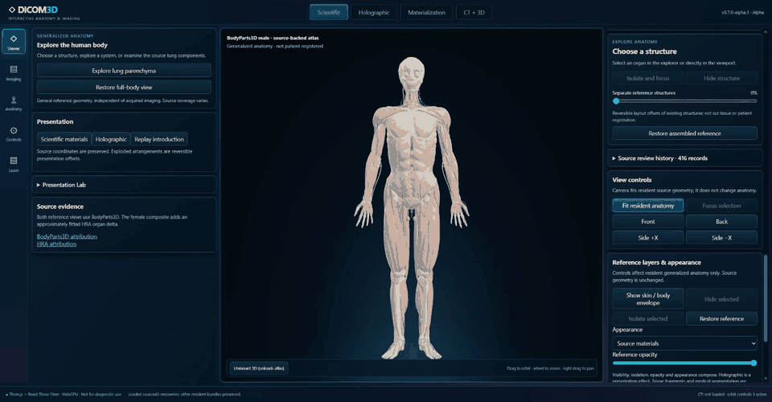
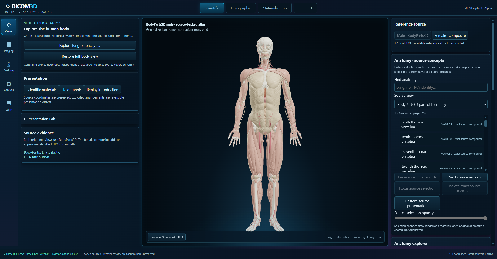
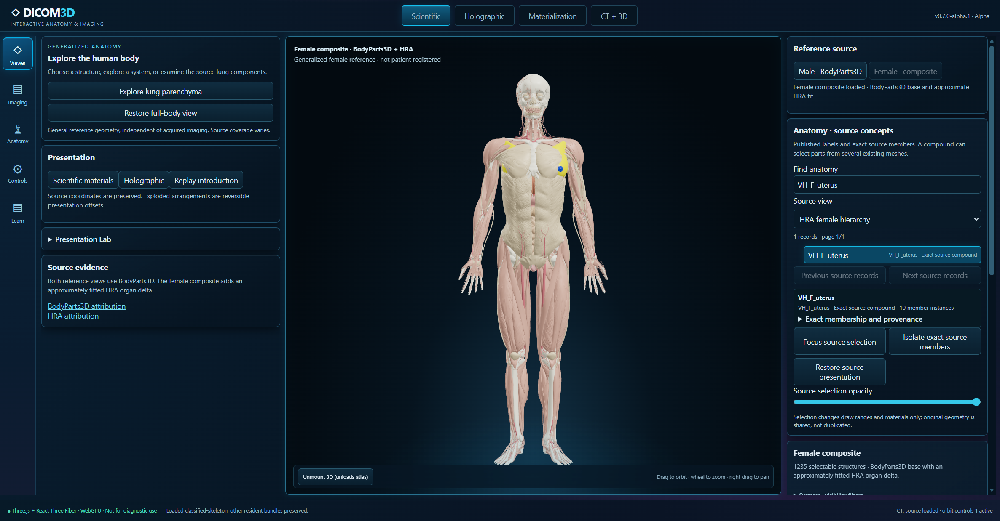
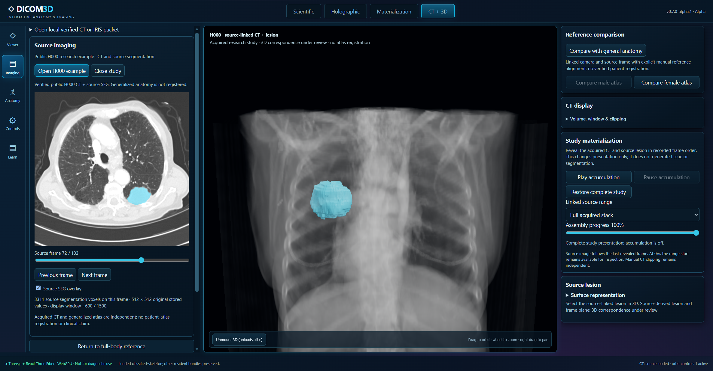
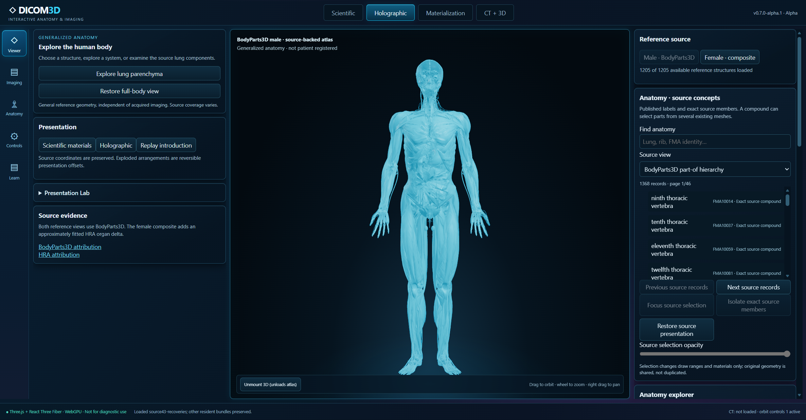

# DICOM3D

<p align="center">
  <a href="https://kennethjsmithdev.github.io/DICOM3D/"><strong>Live Demo</strong></a>
  &nbsp;·&nbsp;
  <a href="prototypes/alpha/three-prototype/"><strong>v0.7.0-alpha.1 Source</strong></a>
  &nbsp;·&nbsp;
  <a href="docs/DOWNLOADS_070_ALPHA.md"><strong>v0.7.0-alpha.1 Downloads</strong></a>
  &nbsp;·&nbsp;
  <a href="docs/INSTALL_070_ALPHA.md#docker-core"><strong>Docker Quick Start</strong></a>
  &nbsp;·&nbsp;
  <a href="docs/INSTALL_070_ALPHA.md#ipmzpm-in-iris"><strong>Native / IRIS Install</strong></a>
</p>

<p align="center"></p>

**v0.7.0-alpha.1 — Anatomy & Imaging Foundation.** *From Pixels to Meaning.*

DICOM3D is an open-source interactive anatomy and medical imaging platform for exploring generalized reference anatomy, public acquired CT and source-linked segmentation. The new web frontend uses **Three.js, React Three Fiber and React**, with **WebGPU preferred and WebGL2 fallback**. This is a research/educational alpha for feedback and further development, **not a clinically validated diagnostic tool**.

**Current alpha:** v0.7.0-alpha.1 source under [`prototypes/alpha/three-prototype/`](prototypes/alpha/three-prototype/), with [versioned downloads and hashes](docs/DOWNLOADS_070_ALPHA.md), [local installation](docs/INSTALL_070_ALPHA.md) and an [acceptance record](docs/RELEASE_070_ALPHA_ACCEPTANCE.md). The published [v0.6.5 release](https://github.com/KennethJSmithDev/DICOM3D/releases/tag/v0.6.5), its Babylon Lite workstation and historical documentation remain available for comparison and rollback.

New here? Follow the [five-minute beginner guide](docs/BEGINNER_GUIDE.md), then explore the [roadmap](ROADMAP.md). Milestones advance through [evidence and release approval](VERSIONING.md), not dates.

## Try it and download

- **[Live Demo](https://kennethjsmithdev.github.io/DICOM3D/):** Web frontend with the available generalized anatomy and approved public H000 CT/SEG research example. Inspect its displayed version and renderer status when evaluating a deployment.
- **[v0.7.0-alpha.1 downloads and source](docs/DOWNLOADS_070_ALPHA.md):** Exact Safe Demo ZIP, locally qualified IPM archive and source-build routes, with hashes and publication status. The static demo needs no IRIS or AI service; the IPM host uses your existing authorized IRIS login.
- **[Published v0.6.5 downloads](https://github.com/KennethJSmithDev/DICOM3D/releases/tag/v0.6.5):** Retained Babylon Lite Safe Demo ZIP and Core **source** ZIP; this is the previous release and rollback reference.
- **[Local alpha installation](docs/INSTALL_070_ALPHA.md):** Standalone Docker Core and authenticated IRIS/IPM setup, with fresh-install qualification separated from upgrades. Historical [v0.6.0 installations](docs/INSTALL_060.md) remain documented for their original artifacts.

## Install and integrate

The Three/R3F **v0.7.0-alpha.1** has separately tested static, Docker Core and fresh IRIS/IPM paths. Follow the [alpha launch guide](docs/LAUNCH_070_ALPHA.md) and exact [download identities](docs/DOWNLOADS_070_ALPHA.md); a GitHub archive does not update Docker Hub, the IPM registry or Open Exchange automatically. There is no native MSI/EXE or qualified in-place upgrade in this release:

- **[Standalone Core Docker Quick Start](docs/INSTALL_070_ALPHA.md#docker-core):** Run the published Linux/amd64 image by its verified digest, or build from source. Core serves the alpha without IRIS, Orthanc or AI. The published payload matches the qualified image; fresh-machine installation and source-build dependency acquisition retain their own evidence boundaries.
- **[IRIS/IPM installation](docs/INSTALL_070_ALPHA.md#ipmzpm-in-iris):** Fresh archive installation, normal authenticated Entry, restart and uninstall were exercised in an isolated IRIS for Health 2026.2 fixture. This hosts the viewer; it does not establish live PACS retrieval or a registry update. Earlier [native/Core installation artifacts](docs/INSTALL_060.md) retain their own version boundaries.
- **[v0.6.0 release downloads](https://github.com/KennethJSmithDev/DICOM3D/releases/tag/v0.6.0)** and **[packaging provenance](docs/PACKAGING_060.md):** Historical distribution identities, source/packaging boundaries and qualification receipts.
- **[v0.6.5 downloads](https://github.com/KennethJSmithDev/DICOM3D/releases/tag/v0.6.5):** Previous Babylon Lite Safe Demo ZIP and Core source ZIP, not a v0.7.0-alpha installer.

For the preserved Babylon Lite workstation, see the [Safe Demo build guide](docs/SAFE_DEMO.md) and [architecture and ownership](docs/ARCHITECTURE.md). Those documents describe the earlier implementation; the alpha's active frontend and source contracts are identified below. See the [changelog](CHANGELOG.md) and [release history](ROADMAP.md) for version-specific milestones.

The earlier workstation also documents a **verified local CT** input route using a volume descriptor and stored pixels kept in the browser. This is a legacy capability, not a claim that arbitrary local DICOM import is qualified in the current alpha.

## What the alpha can do

**Explore expanded anatomy.** The BodyParts3D male reference provides **1,205 source-backed geometry groups across 17 independently loadable bundles**. The **1,235-group female composite** shares that base, excludes/replaces nine groups and adds 39 HRA groups containing 60 source components. These are rendered ownership groups, **not counts of distinct organs**. Published hierarchies support exact component and compound selection without copying geometry; the [coverage table](docs/RELEASE_070_ALPHA_ACCEPTANCE.md#atlas-coverage-and-limits) reports overlapping selection categories separately. The female fit is approximate and retains the shared base skeleton and body shape.

**Interact with a reference.** Search, select, focus, hide, isolate and restore supported geometry. Load and unload independent bundles; choose source-oriented or stylized presentation. The body envelope starts **hidden** so interior anatomy is visible. WebGPU is requested first, and a tested WebGL2 compatibility path remains available. Exact source components and compounds remain distinct from larger-owner proxies and unavailable source relationships; 18 source files remain held rather than being mirrored or relabeled.

**Connect source CT and 3D.** The approved public **H000 CT/SEG** study demonstrates 103 acquired CT frames, source segmentation overlays and related 3D visualization/accumulation. The optional NRX-derived lesion surface is a **display derivative of the supplied SEG**, not whole-scan organ segmentation. Reference anatomy is not spatially registered to that study.

**Learn as you explore.** The contextual Beginner, Explore and Evidence views explain active anatomy, imaging sources, presentation effects, provenance and limitations without requiring AI. The introductory Materialization effect lasts approximately eight seconds and settles into Scientific; Holographic remains selectable. Skip and reduced-motion controls remain available as explicit choices.



Actual frozen alpha.1 runtime on hardware WebGPU; approximately 9.5 seconds of real presentation, exported at reduced resolution. [Capture method and media boundaries](docs/DEMONSTRATION_MEDIA.md).

**Know the boundaries.** This alpha is a public research demonstration. It does not claim diagnosis, treatment guidance, anatomical completeness, arbitrary DICOM/SEG interpretation, clinical validation, general PACS interoperability, production FHIR/AI features or a qualified installed-update wizard. Whole CT display is direct volume rendering, not whole-scan organ segmentation; the native NRX research renderer is separate from the alpha's NRX/R002 lesion-surface bridge. Fresh installation does not establish an installed settings/data migration or rollback.

## Build the research alpha from source

Use Node.js 24 and npm on a supported desktop. From the repository root:

```sh
npm ci --prefix prototypes/alpha/three-prototype
node scripts/build-alpha-distribution.mjs .package/alpha-web "$(git rev-parse HEAD)"
node scripts/preview-static.mjs --root .package/alpha-web --port 0
```

Open the loopback URL printed by the inventory-checked static host. Use a new build directory for each build and Ctrl+C to stop that host. The distribution builder checks the committed atlas index, all 17 bundle hashes and the current HRA supplement, and includes approved H000 assets plus software/source notices. It does not use developer-private scans or paths. See the [alpha source handoff and historical qualification](prototypes/alpha/README.md) for more detail.

## v0.7.0-alpha.1 screenshots

**Actual Three/R3F candidate captures on hardware WebGPU (RX 7900 XT).** These show the qualified `623d81bc` runtime; the [acceptance record](docs/RELEASE_070_ALPHA_ACCEPTANCE.md#candidate-captures) binds their source, viewport and limitations.









The v0.6.5 release and its original screenshots remain preserved; the earlier [female reference](docs/images/visual-060-female-desktop.jpg), [materialization](docs/images/visual-060-materialization.jpg) and [learning](docs/images/visual-060-learning.jpg) captures are also **legacy Babylon Lite** examples.

## Project structure and contributions

- [`prototypes/alpha/three-prototype/`](prototypes/alpha/three-prototype/): Current Three.js/R3F research frontend, atlas assets, manifests, UI, and focused tests.
- [`prototypes/alpha/viewer/src/`](prototypes/alpha/viewer/src/): Shared imaging data/geometry contracts used by the alpha. Source verification is separate from visual styling.
- [`viewer/`](viewer/): Preserved published Babylon Lite workstation source, not the current alpha browser entrypoint.
- [`research/nrx/`](research/nrx/): Separately qualified native rendering/geometry research; do not assume every NRX experiment runs in the public alpha.
- [`EXPERIMENTAL_HANDOFF.md`](EXPERIMENTAL_HANDOFF.md): Historical source-review provenance. Distinguish those earlier checkpoint figures from the current deployment.

To [report a problem](https://github.com/KennethJSmithDev/DICOM3D/issues), include the version, browser/backend, reproducible steps and public-safe screenshots. See [CONTRIBUTING](CONTRIBUTING.md) for focused contributions. [Sponsor DICOM3D](https://github.com/sponsors/KennethJSmithDev) to support anatomy coverage, accessible learning, reproducible installation and imaging integration.

Changes should preserve source identities, laterality, provenance, original CT values, segmentation correspondence and safe cleanup. Keep comments focused on **why a constraint exists** and on non-obvious ownership boundaries. Public issues and contributions are welcome; never add patient scans, identifying records, credentials or proprietary IRIS distributions.

## Research scope, data and licenses

DICOM3D software is **Apache-2.0** (see [LICENSE](LICENSE) and [NOTICE](NOTICE)). The current expanded BodyParts3D assets and HRA female supplement carry their separate **CC BY 4.0** attribution and source-specific conditions; see [expanded atlas notice](prototypes/alpha/three-prototype/expanded-atlas/LICENSE.md) and [HRA supplement notice](prototypes/alpha/three-prototype/atlas-delta/HRA-FEMALE-NOTICE.txt). Older BodyParts3D notices record historical publisher terms; keep them with earlier archives. The public H000 example carries an independent [research data policy](docs/PUBLIC_RESEARCH_DATA_POLICY.md). IRIS software requires separate licensing and deployment.

Generalized atlases, acquired imaging and derived surfaces remain distinct sources. **Not for clinical diagnosis or treatment.**
