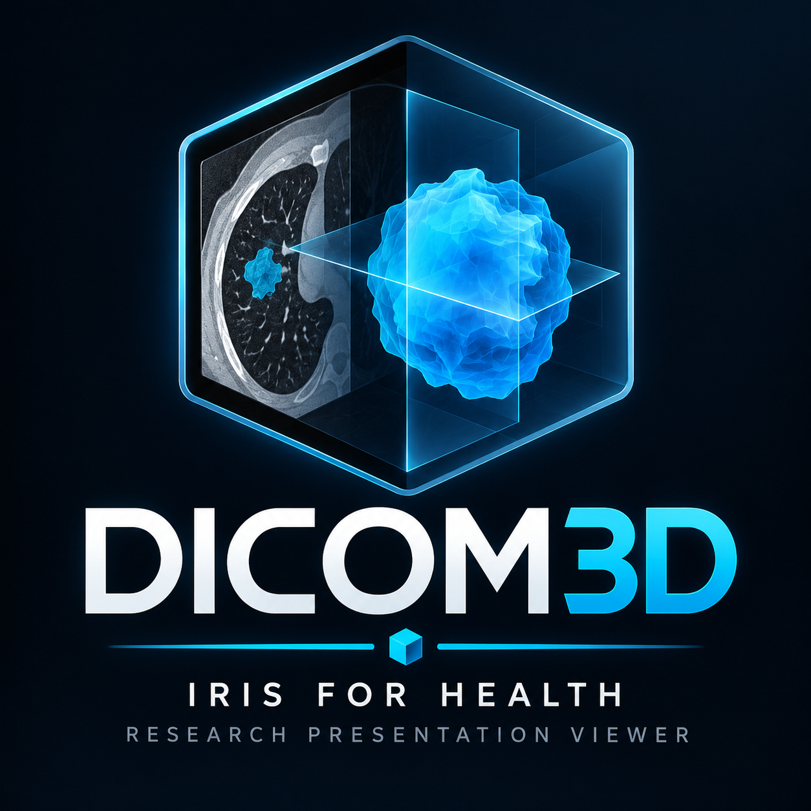

# DICOM3D — native AI Hub contest edition

> This contest edition demonstrates DICOM3D's native InterSystems AI Hub interoperability workflow using the previously qualified Babylon Lite imaging interface. The broader DICOM3D platform continues independently with its Three.js/R3F-based v0.7.0-alpha.1 research prerelease.

**[Contest installation and demonstration](contest/build154/README.md)** · **[Native agent source](contest/build154/src/Native005.Operation.cls)** · **[Broader platform prerelease](https://github.com/KennethJSmithDev/DICOM3D/releases/tag/v0.7.0-alpha.1)**

  

This branch demonstrates a bounded decision-making task: an IRIS Interoperability production uses native `%AI.Agent` to explain a recorded public-research segmentation finding, retrieve restricted FHIR R5 evidence, validate its exact references and select the corresponding lesion in the imaging viewer. A synthetic source-identity mismatch requests review instead of inventing a correction.

The integration reuses DICOM3D's existing Babylon Lite interface. The viewer alone is not the contest agent; the observable native evidence/decision/validation workflow is the contest-specific improvement. DICOM3D as a broader project predates the contest.

Start with the [portable packet instructions](contest/build154/README.md#install-and-run). No private patient data, model weights, credentials or restricted IRIS image are included. The approved public H000 research example is explicit. Authorized Community AI Hub Build154 acquisition and separately supplied model weights are prerequisites. Local fixture authentication is not a production clinical authorization system. This is a research prototype, not diagnosis or clinical deployment.

**Qualification status:** The native explanation/validated lesion-selection and synthetic mismatch paths have been demonstrated. Intermittent CPU inference failures remain unresolved, and a five-run repeatability gate was not completed. Read the [tested scope and known limitations](contest/build154/README.md#tested-scope-and-known-limitations) before installing or demonstrating.

Software: [Apache-2.0](LICENSE). Existing [notice](NOTICE) and [asset-specific attribution](contest/build154/docs/ASSETS.md) remain separate.
