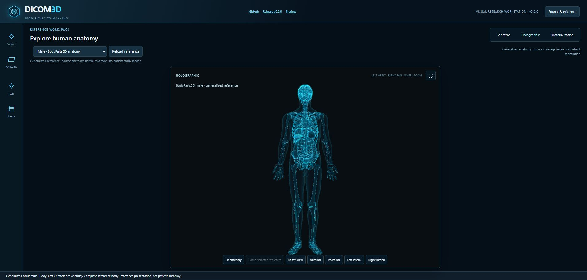

# DICOM3D — Visual Research Workstation

**From Pixels to Meaning.**

<p align="center"><a href="https://kennethjsmithdev.github.io/DICOM3D/"><strong>Live Demo</strong></a> · <a href="docs/RELEASE_060.md"><strong>v0.6.0 Web / Source Release</strong></a> · <a href="docs/INSTALL_060.md"><strong>v0.6.0 Install Guide</strong></a></p>

<p align="center"></p>

DICOM3D is a desktop-first research workstation for exploring generalized anatomy in a central 3D workspace. The v0.6.0 web/source release combines the existing male BodyParts3D and female HRA references with scientific, holographic and bounded materialization presentations. Source geometry, semantic identity and attribution stay intact.

**Release scope:** the published v0.6.0 tag identifies the accepted visual web/source commit. Matching Core/Docker and IRIS/IPM installation artifacts use separately identified packaging completion commits and source snapshots. Obtain exact archives, checksums and qualification receipts from the [v0.6.0 release](https://github.com/KennethJSmithDev/DICOM3D/releases/tag/v0.6.0); see [installation provenance](docs/PACKAGING_060.md). Existing v0.5.1 assets remain immutable. Open Exchange and its registry are separate, user-owned publication surfaces.

## A 3D-first anatomy workspace



Actual local release02 Edge/WebGPU rendering of generalized anatomy. These screenshots are not patient studies or generated concept art. The [original logo](assets/branding/dicom3d-logo.png) remains preserved alongside the semantic-cube icon family.

- A dominant 4:3 3D viewport with collapsible anatomy and presentation tools.
- Scientific source materials, controlled cyan holography and bounded materialization that resolves to the existing mesh.
- Male/female reference selection, semantic picking, hide/show/isolate/restore, opacity, camera presets and focus.
- Orbit, zoom and right-drag pan, with cancellation and reduced-motion controls.
- **Learn**, directly below **Lab**, explains the current source, presentation choices, limitations and attribution without a permanent bottom panel.

See actual captures of [female HRA anatomy](docs/images/visual-060-female-desktop.jpg), [materialization](docs/images/visual-060-materialization.jpg) and [contextual learning](docs/images/visual-060-learning.jpg). Details and evidence limits: [Visual Research Workstation](docs/VISUAL_RELEASE_060.md).

## Source identity and limits

The catalogs contain **33 male and 22 female semantic groups**. A group can own several mesh primitives. These independently sourced references have partial coverage and are not registered to one another or to a patient scan.

Male BodyParts3D lung groups contain source airway/vessel branches rather than complete lung envelopes. Female HRA has its own membership and limitations. Presentation effects preserve these distinctions and do not invent missing anatomy.

**The original v0.6.0 web release and baseline installers are reference-only.** A follow-on `curated-h000` Safe Demo profile now admits exactly five unchanged H000 files for an optional acquired CT/SEG study. An explicit action loads approximately 33.3 MB; generalized anatomy remains the default. Existing source-linked image, segmentation, lesion, contextual learning and presentation controls retain their source identities. Exact artifact/browser qualification and deployed readback are separate from admission. CT screenshots, arbitrary patient imports and private connections remain excluded. See the [data policy](docs/PUBLIC_RESEARCH_DATA_POLICY.md) and [Safe Demo scope](docs/SAFE_DEMO.md).

Camera, materials, clipping and animation are presentation state. This research software makes no clinical, diagnostic, anatomical-accuracy, new-segmentation, registration or physiological-simulation claim.

## Install v0.6.0

- **Standalone Core / Docker:** dicom3d-core-0.6.0.zip, the canonical visual workstation and attributed reference assets, served read-only on loopback.
- **Protected IRIS/IPM:** dicom3d-0.6.0.tgz with prebuilt visual frontend, generated FileCopy inventory, content-bound entry link and existing password/resource protection.
- **Optional IRIS development host:** the existing isolated durable-volume recipe, reconciled to 0.6.0.

Use the exact [installation guide](docs/INSTALL_060.md), [packaging/source instructions](docs/PACKAGING_060.md) and external release qualification receipt. The original v0.6.0 tag is not the later installation source snapshot. [v0.5.1 installers](https://github.com/KennethJSmithDev/DICOM3D/releases/tag/v0.5.1) remain available for rollback with their original checksums.

## Run the web experience locally

Use Node.js 24 and the pinned viewer lockfile. From the repository root:

```powershell
npm ci --prefix viewer
node scripts/build-demo.mjs --profile curated-h000
node scripts/test-demo.mjs --profile curated-h000
Push-Location viewer
node node_modules/vite/bin/vite.js preview --config vite.reference.config.mjs --outDir ../.demo-dist --base /DICOM3D/ --host 127.0.0.1 --port 53260 --strictPort
```

Open `http://127.0.0.1:53260/DICOM3D/`. Stop with Ctrl+C, then use `Pop-Location`. The build uses the existing reference entry and Babylon Lite renderer, without an additional rendering engine or runtime dependency.

Omit `--profile curated-h000` for the default reference-only build; it emits no H000 payload or study route. Core/native admission remains reference-only, and the curated profile is rejected for the installer base. The acquired study retains [TCIA source credits, CC BY 3.0 and use-policy notices](reference/public/demo/h000/NOTICE.md); its historical candidate wording remains unchanged and is reconciled by the separate current owner decision. Reproduce installers from their identified frozen packaging source. The [publication procedure](docs/VISUAL_PUBLICATION_PROCEDURE.md) separates source integration, Pages deployment and actual remote rendering checks.

## History and license

H000 established one source CT/SEG-to-semantic-mesh engineering chain. Later gates added protected IRIS hosting, synthetic presentation slices, generalized anatomy, local imaging and contextual learning. Named receipts establish each bounded claim; this repository is not the complete research evidence store. See [changelog](CHANGELOG.md), [roadmap](ROADMAP.md), [architecture](docs/ARCHITECTURE.md) and [provenance](docs/PROVENANCE.md). v0.5.0/v0.5.1 artifacts remain immutable.

DICOM3D software is Apache-2.0, copyright 2026 KennethJSmithDev personally. Preserve LICENSE, NOTICE and third-party notices. BodyParts3D-derived assets retain the embedded CC BY-SA 2.1 Japan grant and the notice's distinct current publisher-license statement. HRA retains CC BY 4.0 attribution and source limitations. Read the unchanged [BodyParts3D notice](reference/public/reference/BODYParts3D-NOTICE.txt) and [HRA notice](reference/public/reference/HRA-FEMALE-NOTICE.txt). Optional IRIS software is acquired separately under its applicable license.
