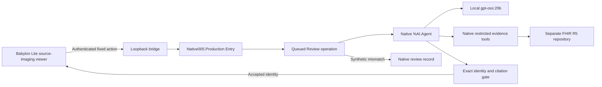

# DICOM3D — native AI Hub contest edition

> This contest edition demonstrates DICOM3D's native InterSystems AI Hub interoperability workflow using the previously qualified Babylon Lite imaging interface. The broader DICOM3D platform continues independently with its Three.js/R3F-based v0.7.0-alpha.1 research prerelease.

DICOM3D makes imaging findings explorable without losing their source evidence. This edition asks a genuine native `%AI.Agent` to explain one recorded lung-mass measurement, retrieve its restricted FHIR R5 evidence, and identify the corresponding structure. A synthetic CT/SEG mismatch takes the review-request path. It is a research prototype, not diagnosis or clinical decision support.

## Tested scope and known limitations

This is a contest research prototype with demonstrated native execution, not a clinically validated system or a completed reliability qualification.

- A clean extraction of the portable packet initialized fresh owned Community Build154 and FHIR R5 containers from separately supplied images and model weights. Actual Babylon rendering, restricted evidence access, UTF-8, a fresh native-agent unselected-to-selected lesion transition, and a native synthetic-mismatch review were witnessed. This was not a clean-OS test or an independent acquisition of the image and 14 GB weights.
- **Intermittent inference remains unresolved.** The pinned CPU provider has returned HTTP500, `prediction aborted, token repeat limit reached`, and a malformed final JSON response. Invalid/failed results were withheld. Later unchanged direct and genuine native requests succeeded; these successes do not establish a fix or a dependable completion rate. No automatic retry or replayed response is used as a success.
- A five-run trial recorded two functional passes, then a PC crash interrupted the third run. The controlled restart and last two runs were not completed. A private memory-monitor defect also prevented full resource qualification for that attempt. Subsequent attempts stopped at crash-related unclean-production startup. **No five-consecutive-run PASS or complete post-crash repeatability is claimed.**
- Supported `Ens.Director.RecoverProduction()` subsequently passed, preserving the message history and all existing request/response payloads. Clean production startup and normal shutdown passed. The interrupted request remains Suspended and was not resubmitted. Recovery is not a new inference or repeatability result; see [crash recovery](docs/RUNTIME.md#after-an-unclean-host-shutdown).
- Local fixture authentication and Docker-operator access are a prototype boundary, not production clinical authorization. Final validation enforces identity/citations and a limitation string; it does not independently fact-check every generated sentence. Research measurements do not establish diagnosis, anatomical accuracy or patient-atlas registration.
- **Local relay availability limitation:** the separate loopback provider relay has no client authentication, and rejected chat requests still consume its twelve-completion allowance. An offline handler test confirmed that local requests can exhaust that allowance and make a valid request return HTTP429. No live hostile-browser path or data disclosure was demonstrated. Use this prototype on a trusted local machine; the authenticated browser bridge does not protect the relay's separate port. The frozen runtime is unchanged.

The frozen executable packet is **186,040,429 bytes**, SHA-256 `86e9e3530620cca96749987dd64c3115fb852904ca1f68208203ed2ed49e5cb3`. This branch's updated documentation is the current disclosure of its tested scope. The frozen ZIP was not rebuilt to add these later documentation notes; its bundled README predates them. Current source runtime files remain byte-identical to that packet; only the documentation/provenance integrity entries are updated here. Source-clone installation and the exact frozen ZIP are distinct byte identities.

## Install and run

Use an extracted contest packet or a checkout of the **AIHub-Contest-Build** branch. Commands below run from its root. Do not use the default branch's broader-platform installer for this edition.

Prerequisites:

- Docker Desktop with a reachable Linux/amd64 engine and Compose; no shared IRIS instance is used.
- Python 3.11+, Node 22+, and separately installed [Ollama](https://ollama.com/download) **0.40.6**. The witnessed Windows setup used Python 3.14.7 and Node 24.21.0; other host versions/platforms are not independently qualified.
- The exact locally loaded Community AI Hub Build154 image and pinned Community2026.2 FHIR image listed in [runtime acquisition](docs/RUNTIME.md).
- An existing, separately authorized `gpt-oss:20b` model store. Required model digest: `9ba9cc2b4e02463b933096090530aef679d534dd91ecc9afadfb2dbfdc59f3c5`. The launcher never downloads models or images. Plan for at least32GiB host RAM and approximately14GiB model storage, in addition to Docker/image storage.

For a new installation, [prepare the pinned model metadata around your separately supplied authorized GGUF](docs/RUNTIME.md#pinned-model-prerequisite) before `up`. This avoids relying on a preexisting developer model definition or on a mutable catalog tag. The packet supplies only small configuration/license files; model weights remain an explicit external prerequisite.

```powershell
python contest/build154/scripts/check.py --offline
$state = Join-Path $env:LOCALAPPDATA 'DICOM3D-contest154/run-001'
python contest/build154/scripts/contest.py up --state-dir $state --project dicom3d-contest154 --model-store '<your existing Ollama model store>' --ollama '<full path to ollama.exe>'
python contest/build154/scripts/check.py --state-dir $state
```

Use an absent state directory and an unused project name for the first `up`. The default ports57400–57403 must be free. `--port-base` changes this four-port range. The launcher validates both image IDs, creates isolated Compose resources, waits up to180seconds for vendor health, installs the existing classes and nine-resource fixture, creates its restricted reader and starts the owned CPU provider/bridge. The first FHIR bootstrap can take several minutes.

The dedicated owned NAT bridge defaults to `10.203.154.0/28`, checked against existing Docker subnets and host routes before creation. Use `--subnet` to select a different unused private /24–/28 if it conflicts. This does not change Docker's default address pools or any existing network; explicit IPAM also works when automatic pools are exhausted. A non-internal bridge is required by this Docker runtime for actual loopback publication; the R5 port is still bound only to127.0.0.1. Containers have ordinary outbound NAT access, not an egress-isolation claim.

Open **http://127.0.0.1:57400/DICOM3D/** (or the printed URL). Authentication is requested only for workflow actions. Username: `contest`. Read the generated bridge password locally from the `passwordFile` path printed by the launcher. Do not post it or commit the state directory. Three independently generated bootstrap/bridge passwords and the FHIR reader password are private files; none is bundled in the packet.

No IPM installation is required for this contest packet: the bootstrap loads its included ObjectScript classes into its own fresh USER namespace. This does not establish IPM distribution qualification.

## Judge demonstration

1. Choose **Scientific**, then **Explore Real CT Study**. This explicitly loads the approved public H000 research example, not private imaging.
2. Open the anatomy inspector. Clear the lung-mass selection if necessary; confirm it is initially unselected.
3. Press **Explain documented finding with native AI Hub** and authenticate. Wait for the actual native agent; historical CPU requests took about121seconds, with a300second bridge deadline.
4. Observe the explanation, accepted `lesion.lung.mass.001`, visible selected state, and the exact two references: `Observation/r5p-h000-mask-volume` and `ImagingSelection/r5p-h000-segment-1`.
5. Press **Review synthetic CT/SEG mismatch**. Observe a new native `REVIEW_REQUESTED` record, its three synthetic evidence references, and unchanged source selection. This is a request for review, not a corrected clinical record.

Allow2–3minutes for narration, excluding model inference. A running viewer alone is not an agent demonstration. This integration adds a bounded workflow to an existing imaging product; the whole DICOM3D platform was not created for this contest.

## Native workflow and source



Source: [production](src/Native005.Production.cls), [entry](src/Native005.Service.cls), [agent and final validator](src/Native005.Operation.cls), [restricted reader](src/Native001.Tools.cls), [agent tools](src/Native005.Tools.cls), [synthetic review](src/Native005.SyntheticTools.cls), [UTF-8 bridge](scripts/server.mjs), [browser adapter](scripts/bridge.js), [bootstrap](scripts/contest.py), [focused checks](scripts/check.py), [approved fixture](fixtures/evidence.json), [provenance](PROVENANCE.json).

The [provider relay](scripts/relay.py) applies a [stateless format projection](scripts/response_format.py) only after a matching native `SelectVerifiedStructure` tool result reports the accepted source identity. It requests the provider's existing [JSON-schema output mode](https://docs.ollama.com/capabilities/structured-outputs) for the final reply. The [schema](selection-response.schema.json) constrains field types, not semantic IDs or citation values; the original native final validator still checks those. Initial tool calls and the mismatch route are unchanged. No generated answer is repaired or reconstructed.

Entry receives a fixed explanation/mismatch event from the bridge. Review runs actual `%AI.Agent` sessions, native tool calls and final validation. The existing browser semantic controller selects the lesion only after accepted ID/citations return. Tools use in-process native toolsets; a separate historical MCP capability test is not represented as the imaging transport here.

The source observation is34,920.615783691406mm³. Generated prose may round it. Exact semantic identity/citations, source Study/Series/SOP bindings, original CT values and geometry remain authoritative. Neither numeric precision nor the explanation establishes independent anatomical accuracy, diagnosis or patient-to-atlas registration.

## Safeguards and boundaries

- The only bridge actions are explanation and synthetic mismatch. It binds loopback, checks authentication and Origin/Host, permits one request at a time and at most four workflow requests per bridge process. Provider relay is limited to12completion calls and the fixed model. No write API for source FHIR resources is exposed by the browser.
- The nine-path native allowlist uses a read-only FHIR role. The local bridge's Basic login is separate from IRIS end-user authentication: invoking IRIS through Docker uses the local Docker operator's authority. This is not a production authorization design.
- Final validation checks the exact semantic identity, two exact citation entries and a nonempty limitation. It is not a general prose fact checker or clinical-safety engine. Unsupported identity/citation results are withheld.
- Startup uses the guarded historical vendor `CSPpwd` path alias and original vendor health checks. Vendor Sharding/GetCacheDirs warnings are retained, not hidden. See [runtime notes](docs/RUNTIME.md).
- State is private synthetic/public research fixture state in owned containers. A container restart/stop preserves its writable layer. Container removal is not data persistence; `down`, image deletion and volume pruning are deliberately not automated.
- The reference anatomy is not registered to the acquired H000 patient. Preserve source-specific licenses and attribution: [asset notices](docs/ASSETS.md), [frontend NOTICE](frontend/NOTICE), [BodyParts3D](frontend/reference/BODYParts3D-NOTICE.txt), [HRA female](frontend/reference/HRA-FEMALE-NOTICE.txt).

## Stop, restart and inspect

```powershell
python contest/build154/scripts/contest.py status --state-dir $state
python contest/build154/scripts/contest.py stop --state-dir $state
python contest/build154/scripts/contest.py start --state-dir $state
```

Stop acts only on recorded exact owned resources and checks process identities before stopping them. Containers, network, state, credentials and evidence are retained. Do not use a global prune. Stop the bridge/provider before manually restarting IRIS; use `stop`/`start` to reestablish relay ordering. No generic automatic reconnect supervisor is claimed.

Calling `start` on this already healthy, identity-matched instance reuses it rather than replacing its listener. A foreign/mismatched listener or partial owned lifecycle is refused. The pinned R5 gateway returns a generic404 for an invalid password, while anonymous access returns401 and missing-resource-role/write attempts return403. The focused check verifies denial against a known existing resource and checks that the failed write created no canary.

Inspect your state directory's `evidence/` for vendor-health snapshots, class compilation, restricted-reader setup, production start/stop, token/tool traces, validated responses and refusals. Never publish that directory wholesale. A timeout is a failed witness, not permission to replay a success or retry indefinitely. On bootstrap failure retain the state directory and inspect logs; do not reset another instance or broaden permissions.

The [official contest announcement](https://community.intersystems.com/post/intersystems-programming-contest-ai-agents-interoperability-workflows) specifies Community Build154 and authorized EAP acquisition. [Contest requirements](https://openexchange.intersystems.com/contest/49) and [the broader prerelease](https://github.com/KennethJSmithDev/DICOM3D/releases/tag/v0.7.0-alpha.1) are separate from this local packet.
